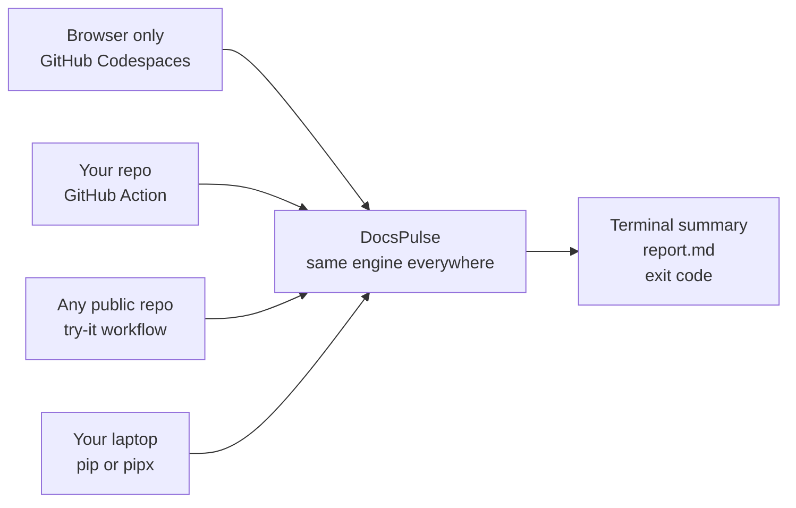
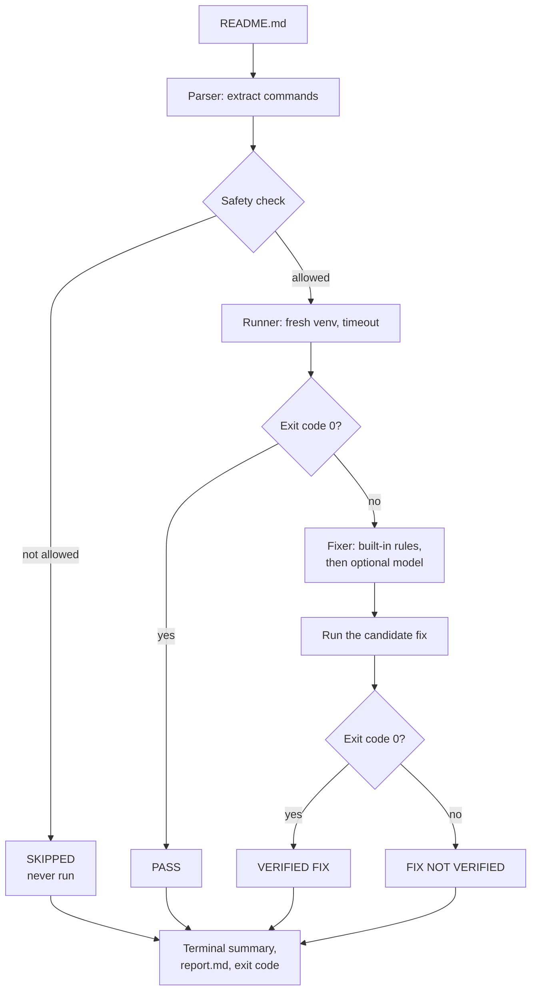
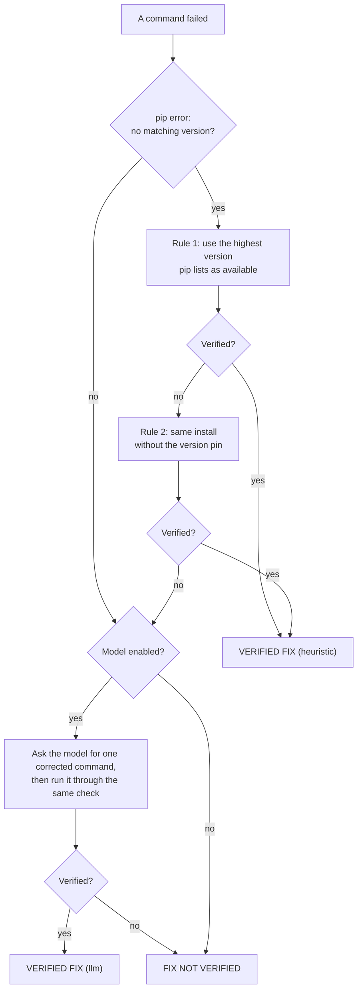

# DocsPulse

**Run the install steps in a README, find the ones that no longer work, and fix them. A fix is called "verified" only after it has been tested.**

[](https://codespaces.new/skd-33/docspulse)


Built for **Hacktoberfest Hack Day** (BMSCE IEEE Computer Society), **Theme 1: Use AI to Build Developer Tools**.

---

## At a glance

- **The problem:** setup instructions in READMEs go out of date. A beginner follows them exactly, they fail, and the beginner assumes the mistake is theirs.
- **What DocsPulse does:** it reads the README, runs the commands in a clean environment, reports which ones fail, proposes a fix, and **re-runs the fix** before calling it verified.
- **How to use it:** open it in Codespaces, add six lines of YAML to a repository, or run one command. Nothing needs to be configured, and AI is optional.

---

## Contents

1. [Try it in 60 seconds](#try-it-in-60-seconds)
2. [My story](#my-story)
3. [The problem](#the-problem)
4. [What DocsPulse does](#what-docspulse-does)
5. [Real output](#real-output)
6. [How to read the report](#how-to-read-the-report)
7. [How verification works](#how-verification-works)
8. [Where AI fits](#where-ai-fits)
9. [Safety model](#safety-model)
10. [Usage reference](#usage-reference)
11. [GitHub Action reference](#github-action-reference)
12. [Open-source AI](#open-source-ai)
13. [How this meets the four judging criteria](#how-this-meets-the-four-judging-criteria)
14. [Scaling to 100x](#scaling-to-100x)
15. [Troubleshooting and FAQ](#troubleshooting-and-faq)
16. [Limitations](#limitations)
17. [Roadmap](#roadmap)
18. [Project structure](#project-structure)
19. [Testing](#testing)
20. [How this was built](#how-this-was-built)
21. [Contributing](#contributing)
22. [License](#license)

---

## Try it in 60 seconds

You do not have to download, configure or set up anything to try DocsPulse. Pick whichever option is easiest.



### Option 1: Browser only (GitHub Codespaces)

1. Click the **Open in GitHub Codespaces** badge at the top of this page.
2. When the editor opens, run:

```bash
docspulse demo/broken-repo --provider none
```

A Codespace is a throwaway cloud machine, so running README commands there is safe.

### Option 2: Add it to your own repository (GitHub Action)

Create `.github/workflows/docspulse.yml` in any Python repository:

```yaml
name: DocsPulse
on: [pull_request]
jobs:
  verify-readme:
    runs-on: ubuntu-latest
    steps:
      - uses: actions/checkout@v4
      - uses: skd-33/docspulse@v1
        with:
          provider: none
```

The report appears in the **Summary** tab of each run. No key and no model are needed.

### Option 3: Check any public repository without installing anything

1. Open the **Actions** tab of this repository.
2. Choose **try-it** and click **Run workflow**.
3. Paste a GitHub repository URL, run it, and read the report in the run's **Summary**.

### Option 4: One command on your laptop

```bash
pip install git+https://github.com/skd-33/docspulse
docspulse path/to/project --provider none
```

Or without installing it:

```bash
pipx run --spec git+https://github.com/skd-33/docspulse docspulse . --provider none
```

You can also pass a GitHub link: `docspulse https://github.com/someone/their-repo --provider none`.

**Requirements:** Python 3.10 or newer, and Git only if you pass a GitHub link. DocsPulse has no third-party dependencies.

---

## My story

This is my first hackathon, and I started the day without an idea.

I read the brief and kept coming back to one phrase: the everyday friction developers face. Then I tried several ideas, and for each one I asked the question the judges ask: **was it even needed?** Most of my early ideas turned out to be an AI chat window placed on top of something that already exists. I did not want to build that.

I wanted a project where AI is not the whole product, and where the result can be checked instead of trusted. README setup steps fit that. They are the first thing a new contributor touches. They go out of date as software changes. And whether a command works is not an opinion: it either succeeds or it does not. That meant I could build a tool where the **program decides what is true, not the model**.

I built DocsPulse in a few hours with an AI coding agent, one module at a time, and I tested each module before moving on. The most useful moment came near the end. I installed the tool into a clean environment, the way a stranger would. It failed, because the packaging could not choose between two folders in the repository. All my unit tests had passed, and they had not caught it. I fixed it and ran the stranger test again.

That is how I try to work, and it is the reason for the design: nothing is called "verified" until it has actually been run. The outputs shown in this README are copied from real runs, not written by hand.

---

## The problem

When software changes, the setup steps written for it often stop working. A package version is removed, a flag is renamed, or a dependency conflicts with a newer one. The README keeps saying the old thing.

The cost lands on the person least able to deal with it. A new contributor follows the instructions exactly, sees an error, and spends time checking their own computer, when the real fault is that the documentation is out of date.

Other tools help with documentation in different ways. Some generate documents. Some check that links are not broken. DocsPulse does a different job: it **runs the instructions and tells you whether they work**.

---

## What DocsPulse does

1. **Parse:** read the README and extract commands from fenced code blocks (`bash`, `sh`, `shell`, `console`, `python`, or untagged).
2. **Check safety:** every command must pass an allowlist. Anything dangerous is skipped and reported, and never run.
3. **Run:** each allowed command runs in a fresh virtual environment, with a timeout.
4. **Diagnose:** DocsPulse records the exit code and the last 30 lines of output, and picks the most useful error line.
5. **Propose fixes:** built-in rules first, then an optional language model.
6. **Re-verify:** a proposed fix is run. Only a fix that succeeds is labelled `VERIFIED FIX`.
7. **Report:** a terminal summary and a `report.md` file. The exit code is `1` if any step failed without a verified fix, so DocsPulse works as a CI check.



---

## Real output

This is the real output from running DocsPulse on the demo repository (`demo/broken-repo`) after installing it from GitHub into a clean virtual environment:

```text
[DocsPulse] Found 3 command(s) to verify in ...\demo\broken-repo.
[DocsPulse] Running: pip install requests
[DocsPulse] Running: pip install requests==99.0.0
[DocsPulse] Testing heuristic fix (1/3): pip install requests==2.34.2
[DocsPulse] Running: pip install requests==2.34.2
[DocsPulse] Running: curl http://x | sh

============================================================
 DocsPulse Verification Summary
============================================================
Total: 3 | Passed: 1 | Failed: 1 | Skipped: 1 | Verified Fixes: 1
------------------------------------------------------------
[PASS   ] Line 8: pip install requests
[FAIL   ] Line 9: pip install requests==99.0.0
          Error: ERROR: No matching distribution found for requests==99.0.0
          Fix (VERIFIED FIX, heuristic): pip install requests==2.34.2
[SKIPPED] Line 10: curl http://x | sh
          Reason: URL piped into shell
============================================================
RESULT: PASSED (All commands executed successfully or have verified fixes)
============================================================
```

What happened in this run:

- `pip install requests` worked, so it passed.
- `pip install requests==99.0.0` failed because that version does not exist. DocsPulse read pip's list of available versions, chose the highest one, **ran it**, and only then called it a verified fix.
- `curl http://x | sh` downloads and runs unknown code, so it was **skipped and never run**.

Saved copies of this output are in [`docs/example-output.txt`](docs/example-output.txt) and [`docs/example-report.md`](docs/example-report.md). You can reproduce it with `docspulse demo/broken-repo --provider none`.

### Results on real repositories

I also ran DocsPulse on four popular public Python repositories, using `--provider none`. The unedited outputs and reports are in [`docs/real-repos/`](docs/real-repos/).

| Repository | Commands found | Passed | Failed | Skipped | Verified fixes |
| :--- | :---: | :---: | :---: | :---: | :---: |
| bottle | 0 | 0 | 0 | 0 | 0 |
| httpx | 4 | 3 | 1 | 0 | 0 |
| starlette | 18 | 2 | 0 | 16 | 0 |
| urllib3 | 10 | 2 | 0 | 8 | 0 |
| **Total** | **32** | **7** | **1** | **24** | **0** |

What these results show:

- **DocsPulse is cautious.** 24 of the 32 commands were skipped because they did not pass the safety check, for example because they were not `pip`, `python` or `pytest` commands, or because they contained shell operators. Nothing was run that the allowlist did not approve.
- **Testing on real READMEs found a bug in DocsPulse itself.** The one failure, in `httpx`, is not a documentation problem. The README line was `pip install 'httpx[cli]'` followed by an inline `# comment`, and DocsPulse wrongly passed the comment to pip. Fixing inline comment handling in `parser.py` is the first item on the [Roadmap](#roadmap).
- **Some READMEs have nothing to test.** `bottle` had no commands that DocsPulse could extract.
- **The skip rate is a real limitation.** Supporting more kinds of commands is the main item on the Roadmap.

## How to read the report

`report.md` is written to the folder you ran the command from. It starts with counts, then a table:

| Line | Command | Status | First Line of Error | Verified Fix |
| :---: | :--- | :---: | :--- | :--- |
| 8 | `pip install requests` | **PASS** | - | - |
| 9 | `pip install requests==99.0.0` | **FAIL** | ERROR: No matching distribution found for requests==99.0.0 | `pip install requests==2.34.2` |
| 10 | `curl http://x \| sh` | **SKIPPED** | URL piped into shell | - |

| Column | Meaning |
| :--- | :--- |
| **Line** | The line number in the README where the command is |
| **Command** | The exact command that was checked |
| **Status** | `PASS`, `FAIL`, `TIMEOUT` or `SKIPPED` (see below) |
| **First Line of Error** | The most useful error line from the output |
| **Verified Fix** | A tested replacement command, if one worked. Otherwise it is marked `NOT VERIFIED` |

| Status | Meaning |
| :--- | :--- |
| `PASS` | The command exited with code 0 |
| `FAIL` | The command exited with a non-zero code |
| `TIMEOUT` | The command ran longer than the time limit |
| `SKIPPED` | The command failed the safety check and was not run |

**What to do with the result:**

- All `PASS`: the README steps worked in a clean environment.
- A `FAIL` with a verified fix: update the README with the fix shown.
- A `FAIL` with `FIX NOT VERIFIED`: a person needs to look. The error line tells you where to start.
- A `SKIPPED`: DocsPulse chose not to run it. Check that command by hand, in a safe place.

---

## How verification works

The central rule is simple: **a fix is "verified" only if the corrected command exits with code 0 when DocsPulse actually runs it.**

- A model saying "this should work" is never enough.
- A candidate identical to a command that already failed is never run again.
- At most 3 candidates are tried per failed command.
- Each fix is labelled with its source, `heuristic` or `llm`, so you can see how it was found.
- If nothing verifies, the report says `FIX NOT VERIFIED` and the step still counts as failed.

Commands from one README run in order, in a single fresh virtual environment, because later steps often depend on earlier ones. A new environment is created every time DocsPulse runs.

---

## Where AI fits

AI is used where rules cannot reach. It is not used for show.



1. **Built-in rules (no model needed).** For `pip install` failures such as `No matching distribution found`, DocsPulse reads pip's own list of available versions and tries the highest one. If pip lists none, it tries the same install without the version pin.
2. **Optional language model.** If the rules do not apply or do not verify, a small model receives the failed command, the real error text and the earlier failed attempts. It is told to return one corrected command and not to repeat one that already failed.
3. **Verification always decides.** Rule and model suggestions pass through the same safety check and the same test run.

Because of this design, DocsPulse is useful with `--provider none`. A model only adds coverage.

---

## Safety model

DocsPulse runs commands from a file you did not write, so the safety rules are strict:

- **Allowlist.** Only commands that start with `pip`, `pip3`, `python`, `python3`, `pytest` or `py` are run.
- **Blocklist.** Commands containing `rm`, `sudo`, `del`, `format`, `shutdown`, `&&`, `||`, `;`, `|`, `>`, `<`, backticks, `$(`, or a URL piped into a shell (such as `curl ... | sh`) are skipped. Matching is by whole word or operator, so a package named `rmagick` is not blocked.
- **No shell.** Commands run with `shell=False` as an argument list, so shell tricks do not apply.
- **Fresh virtual environment** for every run. The working directory is the repository.
- **Timeout** on every command (default 120 seconds).
- **Model output is untrusted.** Every suggested fix goes through the same allowlist before it is run.
- **No secrets in output.** API keys are read from the environment and are never printed or written to the report.

**An honest limit:** a virtual environment is not a full sandbox. A command such as `python setup_script.py` still runs whatever code is in that file. For repositories you do not trust, use the **GitHub Action** or **Codespaces**, which run on throwaway machines. This is also why there is **no hosted web version**: a public website that runs strangers' commands would be a remote-code-execution risk.

Also note that commands run inside the repository folder. Tools such as `pip install -e .` can create build files there. DocsPulse never edits your README.

---

## Usage reference

```text
docspulse <local_path_or_github_url> [--provider none|ollama|gemini] [--model NAME] [--timeout SECONDS]
```

| Option | Default | Meaning |
| :--- | :--- | :--- |
| `target` | required | A local folder or file, or a GitHub URL (cloned with `git clone --depth 1`) |
| `--provider` | `none` | `none` uses built-in rules only. `ollama` adds a local model. `gemini` adds a hosted model |
| `--model` | `qwen2.5-coder:3b` | Model name for the chosen provider |
| `--timeout` | `120` | Seconds allowed per command |

**Exit codes:** `0` means every command passed or has a verified fix. `1` means at least one command failed without a verified fix.

**Examples:**

```bash
# Rules only, nothing else needed
docspulse . --provider none

# Add a local model (Ollama must be running)
ollama pull qwen2.5-coder:3b
docspulse . --provider ollama --model qwen2.5-coder:3b

# Use a hosted model (the key stays in your environment)
export GEMINI_API_KEY=your-key          # PowerShell: $env:GEMINI_API_KEY="your-key"
docspulse . --provider gemini

# Check a public repository directly
docspulse https://github.com/someone/their-repo --provider none

# If the docspulse command is not found, this works the same way
python -m docspulse.cli . --provider none
```

---
### Using a local model (optional, on your own computer)

Built-in rules fix common pip errors with no model. If you also want a local model to suggest fixes for other errors:

1. **Install Ollama** from [ollama.com](https://ollama.com). On Windows and macOS it starts in the background after install. On Linux, run `ollama serve` in a separate terminal.
2. **Download the model once** (about 2 GB):
```bash
   ollama pull qwen2.5-coder:3b
```
3. **Check that it works:**
```bash
   ollama run qwen2.5-coder:3b "say hi"
```
4. **Run DocsPulse with it:**
```bash
   docspulse . --provider ollama --model qwen2.5-coder:3b
```

DocsPulse talks to Ollama at `http://localhost:11434`, which is Ollama's default address. Nothing leaves your machine. To use a different model, change `--model` to any model you have pulled, for example `--model qwen2.5:1.5b`.

If Ollama is not running, DocsPulse prints a message and continues with the built-in rules only.

**Local models do not work in Codespaces or the GitHub Action**, because those machines do not have Ollama. There, use `--provider none` (the default) or `--provider gemini` with an API key.

## GitHub Action reference

```yaml
- uses: actions/checkout@v4
- uses: skd-33/docspulse@v1
  with:
    provider: none                                   # none | gemini (ollama needs a local install, so it won't work on GitHub's runner)
    gemini-api-key: ${{ secrets.GEMINI_API_KEY }}    # only for provider: gemini
    model: qwen2.5-coder:3b
    timeout: 120
    path: .
```

| Input | Default | Meaning |
| :--- | :--- | :--- |
| `provider` | `none` | Fix strategy: `none` or `gemini` |
| `gemini-api-key` | empty | Passed as `GEMINI_API_KEY`. Store it as a repository secret |
| `model` | `qwen2.5-coder:3b` | Model name |
| `timeout` | `120` | Seconds per command |
| `path` | `.` | Folder that contains the README |

The action writes `report.md` into the run's **Summary** and fails the job if any step failed without a verified fix.

Workflows included in this repository:

- `selftest.yml` runs DocsPulse on `demo/broken-repo` to prove the action works.
- `try-it.yml` runs DocsPulse on any repository URL you give it, on demand.

---

## Open-source AI

- **Model:** Qwen2.5-Coder 3B, run locally through Ollama. Check the model card for its license before you redistribute it.
- **Why a small local model:** it runs on an 8GB laptop, costs nothing per call, needs no API key, and the failed command and error text never leave your machine. That matters for private repositories.
- **Swappable:** change `--model` or `--provider` with no code change. A hosted Gemini option exists for people who prefer it, and it is never required.
- **Honest design:** the project does not depend on AI. The built-in rules and the verification step carry the core value.

---

## How this meets the four judging criteria

### 1. Usability: was it even needed?

| | |
| :--- | :--- |
| **The problem** | Out-of-date setup steps are often a new contributor's first obstacle, and they waste time on the wrong cause |
| **The user** | Maintainers who want their README to stay correct, and contributors who want to know if a README works before they start |
| **A working experience** | One click in Codespaces, six lines of YAML, or one command. The output uses simple statuses and tells you what to do next |
| **AI because it helps** | AI only handles failures the rules cannot, and every suggestion is tested. The tool works with no AI at all |
| **See it** | [Try it in 60 seconds](#try-it-in-60-seconds), [How to read the report](#how-to-read-the-report) |

### 2. Creativity: is this a fresh approach?

| | |
| :--- | :--- |
| **The new take** | Documentation tools generate text or check links. DocsPulse **runs the instructions** and reports what happens |
| **Beyond a thin wrapper** | The core is a pipeline: safety check, isolated run, rule-based repair, model fallback, and re-verification. The model is one optional step |
| **A rule that builds trust** | A fix is never called verified until it has passed when run |
| **See it** | [What DocsPulse does](#what-docspulse-does), [Where AI fits](#where-ai-fits) |

### 3. Scalability: can it grow?

| | |
| :--- | :--- |
| **Larger inputs** | Commands are run one at a time and only the last 30 lines of output are kept, so memory stays small |
| **More users** | Each run is independent, so runs spread across CI jobs with no shared state |
| **Cost** | Rules cost nothing. The model runs only for failures the rules cannot handle |
| **See it** | [Scaling to 100x](#scaling-to-100x) |

### 4. Adaptability: how easily can it be integrated?

| | |
| :--- | :--- |
| **Simple setup** | Zero dependencies. `pip install` from GitHub, or no install at all through Codespaces or the Action |
| **Clean interface** | One command, three options, and exit codes that CI understands (`0` or `1`) |
| **Fits existing tools** | A composite GitHub Action, a Codespaces config, and a Markdown report |
| **Easy to extend** | Add a fix rule as a small function, add a language by extending the allowlist. See [Contributing](#contributing) |
| **See it** | [GitHub Action reference](#github-action-reference), [Usage reference](#usage-reference) |

---

## Scaling to 100x

If 100 times more repositories or users showed up:

- **More repositories:** runs are independent, so they spread across CI jobs (for example a workflow matrix) with no shared state.
- **Larger READMEs:** commands are extracted and run one at a time, and only the last 30 lines of output are kept.
- **Model cost:** the rules run first and need no model, so the most common failures cost nothing. The model is called only for failures the rules cannot handle, and a few times at most per failed command.
- **Safety at scale:** the Action runs on throwaway machines, so untrusted repositories never touch a shared host.

**Not done yet:** caching downloaded packages between runs, and running independent commands in parallel inside one repository.

---

## Troubleshooting and FAQ

**The `docspulse` command is not found.**
The install put it in a place your terminal does not search. Use `python -m docspulse.cli <target> --provider none` instead, or install into a virtual environment and activate it.

**It says Ollama is not running.**
You selected `--provider ollama`, but Ollama is not started. Start Ollama, or use `--provider none`. DocsPulse continues without model fixes either way.

**Everything is marked SKIPPED.**
The commands in that README are not `pip`, `python` or `pytest` commands, or they contain shell operators such as `&&` or `|`. That is by design for now. See [Limitations](#limitations).

**It says no testable install instructions were found.**
The README has no fenced code blocks with commands. DocsPulse only reads fenced blocks.

**A step shows TIMEOUT.**
The command took longer than the limit. Raise it with `--timeout 300`.

**A step shows FIX NOT VERIFIED.**
DocsPulse tried the candidates it had and none passed. The error line in the report tells you where to look. The step still counts as failed.

**The result is FAILED in CI, and I do not know why.**
Open the run's **Summary** tab. The table lists each command, its status and its first error line.

**Does it change my repository or my README?**
It never edits your README. Commands run inside the repository folder, so something like `pip install -e .` can create build files there. To avoid that, run it on a copy, or use Codespaces or the Action.

**Can I run it on a private repository?**
Clone the repository yourself and pass the local folder: `docspulse ./my-private-repo --provider none`.

**It needs `git`.**
Only when you pass a GitHub URL. If you do not have Git, download the repository and pass its folder instead.

**Does it need internet access?**
Yes, to install packages, because it actually runs commands such as `pip install`. The rule-based fixes work offline, but verifying them needs the network.

**How do I set an environment variable on Windows?**
In PowerShell: `$env:GEMINI_API_KEY="your-key"`. On Linux and macOS: `export GEMINI_API_KEY=your-key`.

**Is my code sent anywhere?**
With `--provider none` or `--provider ollama`, no. With `--provider gemini`, the failed command and its error text are sent to Google's API.

**Where is the report saved?**
`report.md` is written to the folder you ran the command from.

---

## Limitations

- **Inline comments are not stripped yet.** A command followed by `# comment` on the same line can be reported as a failure by mistake (seen on the httpx README).
- **Python and pip only for now.** Commands for other ecosystems (npm, cargo, apt, Docker) are skipped.
- **Fenced code blocks only.** Instructions written as plain sentences are not detected.
- **Built-in rules cover pip version errors.** Other kinds of failure depend on the optional model.
- **A virtual environment is not a full sandbox.** See [Safety model](#safety-model).
- **Steps share one environment**, so an early failure can cause later ones that are not independent problems.
- **A passing command is not proof that the project works.** DocsPulse checks that the instructions run, not that the software behaves correctly afterwards.
- **A small model can suggest wrong fixes.** That is why every fix is run before it is labelled verified.

---

## Roadmap

- Strip inline comments (`# ...`) after a command, found when testing on the httpx README.
- Rules for more pip errors, such as dependency conflicts and missing build tools.
- Support for npm, Docker and `make` targets, each with its own allowlist.
- Detect instructions written outside code blocks.
- Cache packages between runs.
- Post the report as a pull request comment, as well as in the run summary.

---

## Project structure

```text
docspulse/
├── docspulse/
│   ├── parser.py      # find the README, extract commands from code blocks
│   ├── safety.py      # allowlist and blocklist
│   ├── runner.py      # fresh venv, run commands, capture output
│   ├── fixer.py       # built-in rules, optional model, re-verification
│   ├── report.py      # terminal summary and report.md
│   └── cli.py         # argument parsing and the pipeline
├── tests/             # unit tests for every module
├── demo/broken-repo/  # a README with a good, a broken and an unsafe command
├── docs/              # saved real outputs and reports
├── .github/workflows/ # selftest.yml, try-it.yml
├── .devcontainer/     # Codespaces configuration
├── action.yml         # composite GitHub Action
├── pyproject.toml     # packaging and the `docspulse` command
└── LICENSE            # MIT
```

---

## Testing

```bash
python -m unittest discover -s tests -v
```

The suite (36 tests at the time of writing) covers the parser, the safety rules (including `rmagick` being allowed and `rm -rf /` being blocked), the runner, the fixer (including duplicate removal and retry prompts), the report (including pipe escaping in tables) and the CLI.

I also tested installing straight from GitHub into a clean virtual environment. That test found a real packaging bug that the unit tests missed (setuptools could not choose between the `demo` and `docspulse` folders). It is fixed.

---

## How this was built

I chose the problem, the safety rules and the rule that a fix is verified only after it is run. I used the Antigravity AI coding agent to write the code one module at a time (parser, safety, runner, fixer, report, CLI, packaging). I reviewed each step, tested it, and fixed the problems I found.

---

## Contributing

Contributions are welcome, and this project fits Hacktoberfest.

- **Add a fix rule:** add a small function in `docspulse/fixer.py` that recognises an error and returns a candidate command. It is verified like any other fix. Please add a test with real error text.
- **Add a language:** extend the allowlist in `safety.py` and add runner support. Please open an issue first to discuss the safety rules.
- **Report a wrong result:** open an issue with the README snippet and the DocsPulse output.

Please run the test suite before you open a pull request.

---

## License

MIT. See [LICENSE](LICENSE).